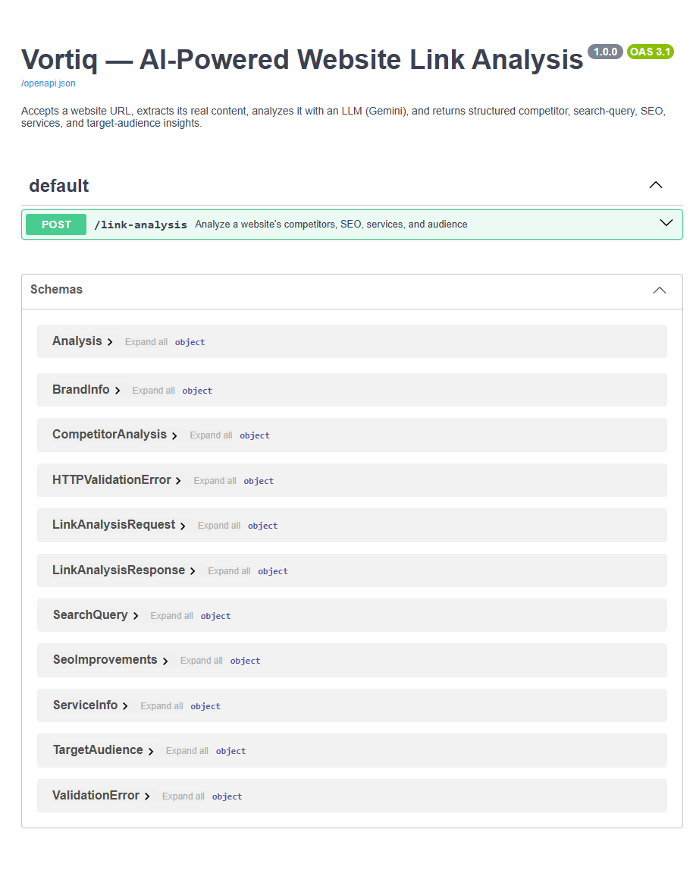

# Vortiq — AI Website Link Analysis

**Live Demo:** [https://vortiq-9h0z.onrender.com](https://vortiq-9h0z.onrender.com) · **API Docs:** [https://vortiq-9h0z.onrender.com/docs](https://vortiq-9h0z.onrender.com/docs) · **Endpoint:** `POST https://vortiq-9h0z.onrender.com/link-analysis`

<div align="center">
  
</div>

## About The Project

Vortiq is an AI-powered website link analysis API: a FastAPI service that accepts a website URL, fetches and cleans its real content, analyzes it with a real LLM (Google Gemini), and returns structured competitor, search-query, SEO, services, and target-audience insights — all in one request. Built as a timed Python backend engineering practical test (FastAPI + LLM integration).

Unlike a tool that fabricates plausible-sounding insights, Vortiq extracts genuine page content (title, meta description, cleaned visible text) before ever calling the LLM, enforces a strict JSON schema on the model's output via Gemini's native structured-output support, and validates SSRF-sensitive input so a submitted URL can never be used to probe internal/private network addresses.

### Key Features

- **`POST /link-analysis`** — one endpoint, five structured insight sections, from a single submitted URL
- **Real Website Extraction** — a genuine HTTP fetch + BeautifulSoup cleaning pass (strips script/style/nav/footer/forms before any text reaches the LLM)
- **Schema-Enforced LLM Output** — Gemini's `responseSchema` constrains the model's JSON shape at the API level, not just by prompt instruction
- **SSRF Protection** — every submitted URL's hostname is resolved and checked against private/loopback/link-local/multicast/reserved IP ranges before any request is made (blocks the classic `169.254.169.254` cloud-metadata target, `127.0.0.1`, `10.x`, `localhost`, etc.)
- **Honest Failure Handling** — a bad URL, an unreachable website, an LLM error, or a malformed LLM response all degrade to a clean `{"success": false, "error": "..."}` result, never a raw 500 or a fabricated "success"
- **Real LLM Cost/Speed/Accuracy Research** — see `docs/llm_research.md`, with pricing fetched live from Google/OpenAI/Anthropic's own pricing pages, not invented
- **Interactive Swagger docs** at `/docs`
- **30 automated tests** (`pytest`), all external HTTP mocked — zero network calls in the default suite — plus a separate, opt-in live end-to-end suite

## Built With

- [FastAPI](https://fastapi.tiangolo.com/) - web framework and request validation
- [Uvicorn](https://www.uvicorn.org/) - ASGI server
- [Pydantic v2](https://docs.pydantic.dev/) - request/response schemas
- [HTTPX](https://www.python-httpx.org/) - async HTTP client for website fetching and the Gemini API
- [BeautifulSoup4](https://www.crummy.com/software/BeautifulSoup/) - HTML cleaning and content extraction
- [Google Gemini API](https://ai.google.dev/) - LLM-powered analysis with native structured output
- [pytest](https://docs.pytest.org/) / [pytest-asyncio](https://github.com/pytest-dev/pytest-asyncio) / [respx](https://lundberg.github.io/respx/) - async test suite with mocked HTTP

## Prerequisites

- **Python** (3.10+, developed and tested on 3.11)
  ```bash
  python --version
  ```

## Installation

### 1. Clone the Repository

```bash
git clone https://github.com/yourusername/vortiq.git
cd vortiq
```

### 2. Set Up the Environment

```bash
python -m venv .venv
.venv\Scripts\activate        # Windows; use `source .venv/bin/activate` on macOS/Linux
pip install -r requirements.txt
cp .env.example .env
```

### 3. Configure Your Gemini API Key

Get a free key at [aistudio.google.com/apikey](https://aistudio.google.com/apikey), then set it in `.env`:

```env
GEMINI_API_KEY=your-key-here
GEMINI_MODEL=gemini-3.5-flash-lite
```

**Never commit a filled-in `.env`** — it's already gitignored.

### 4. Run the Application

```bash
uvicorn app.main:app --host 0.0.0.0 --port 4000
```

Visit `http://localhost:4000/docs` to see the interactive Swagger UI (pictured above).

## Usage

### Analyze a Website

```bash
curl -X POST http://localhost:4000/link-analysis \
  -H "Content-Type: application/json" \
  -d '{"url": "https://example.com"}'
```

### Reading a Result

A successful response includes `brand` and a five-section `analysis` object (competitor analysis, target search queries, SEO improvements, top services, target audience). A failure — bad URL, unreachable site, LLM error, malformed LLM output — returns `{"success": false, "website": "...", "error": "..."}` instead of a crash.

This is a **real, actual response** captured from a live call against `https://httpbin.org` with a real Gemini API key (full, unedited capture in `evidence/live_analysis_response.json`):

<details>
<summary>Real live <code>/link-analysis</code> response (click to expand)</summary>

```json
{
  "success": true,
  "website": "https://httpbin.org",
  "brand": {
    "name": "httpbin.org",
    "category": "Developer Tool / HTTP Request & Response Testing Service",
    "summary": "httpbin.org provides a simple HTTP request and response testing service with body-echo endpoints, header inspection, and utility forms designed for testing HTTP clients."
  },
  "analysis": {
    "competitor_analysis": {
      "brand_overview": "httpbin.org is an online utility enabling developers to test HTTP requests and inspect responses with built-in endpoints for various HTTP verbs, headers, and request bodies under specific rate limits.",
      "competitors": [
        {"name": "Postman Echo", "strengths": ["Well-integrated with Postman client"], "weaknesses": ["Tightly coupled to Postman ecosystem"]},
        {"name": "Beeceptor", "strengths": ["Custom mock endpoints and visual dashboard"], "weaknesses": ["Requires account/configuration"]},
        {"name": "Webhook.site", "strengths": ["Real-time inspection via web UI"], "weaknesses": ["Focused on webhooks, not raw HTTP verb testing"]}
      ],
      "your_strengths": ["Simple and lightweight with zero registration required", "Clearly documented rate limits"],
      "opportunities": ["Provide richer response mock configurations"],
      "note": "Competitors listed are industry-standard alternative HTTP mocking/echo services suggested as realistic alternatives for developer testing workflows."
    },
    "target_search_queries": [
      {"query": "test http post request online", "platforms": ["Google", "Bing"], "intent": "Transactional"},
      {"query": "http echo service api", "platforms": ["Google", "DuckDuckGo"], "intent": "Informational"}
    ],
    "seo_improvements": {
      "primary_keyword": "HTTP Request & Response Service",
      "recommended_title": "httpbin.org - Simple HTTP Request & Response Service for Developers",
      "meta_description": "A simple HTTP Request & Response Service. Test your HTTP clients with body-echo endpoints, header inspection, and request utilities."
    },
    "top_services": [
      {"service_name": "HTTP Body Echo Endpoints", "description": "Endpoints such as /post, /put, /patch that echo back the request body.", "inferred": false}
    ],
    "target_audience": {
      "primary_audience": ["Software Developers", "API Developers", "QA Automation Engineers"],
      "industries": ["Software Engineering", "Information Technology"],
      "customer_needs": ["Reliable endpoints to test HTTP clients and libraries"]
    }
  },
  "error": null
}
```

(Truncated for readability — the full response, with every field, is in `evidence/live_analysis_response.json`. Note it correctly identified httpbin.org as a developer testing tool rather than forcing a generic "business" framing onto it — a real demonstration of the LLM understanding actual page content rather than returning boilerplate.)

</details>

### API Endpoints

- `POST /link-analysis` - analyze a website and return structured insights
- `GET /docs` - interactive Swagger UI
- `GET /openapi.json` - raw OpenAPI schema
- `GET /` - service info / pointer to `/docs`

## Project Structure

```text
Vortiq/
├── app/
│   ├── main.py                  # FastAPI app, exception handlers
│   ├── config.py                # Environment-based settings
│   ├── schemas.py                # Request/response models + input validation
│   ├── services/
│   │   ├── website_extractor.py  # Real HTTP fetch + BeautifulSoup cleaning
│   │   ├── llm_service.py        # Gemini API client with schema-enforced JSON output
│   │   └── analysis_service.py   # Orchestration: fetch -> extract -> LLM -> validate
│   └── utils/
│       └── validators.py         # URL validation + SSRF protection
├── tests/
│   ├── test_validators.py
│   ├── test_website_extractor.py
│   ├── test_llm_service.py
│   ├── test_link_analysis.py
│   └── test_live.py              # Opt-in, real network, excluded from the default run
├── docs/
│   └── llm_research.md           # Full LLM cost/speed/accuracy comparison and recommendation
├── evidence/                      # Real pytest run, dashboard screenshot
├── .env.example
├── .gitignore
├── pytest.ini
├── requirements.txt
└── README.md
```

## Features in Detail

### Website Extraction

- `app/services/website_extractor.py` fetches the real page (following redirects), rejects non-HTML content types and HTTP error statuses, and strips `<script>`, `<style>`, `<nav>`, `<footer>`, `<header>`, `<form>`, `<iframe>`, and `<svg>` before extracting visible text
- The extracted text is capped (`Settings.max_extracted_chars`, default 12,000 characters) to bound the LLM prompt size — see `docs/llm_research.md` for why this matters for cost

### SSRF-Protected Input Validation

- `app/utils/validators.py`'s `validate_public_url` resolves the submitted URL's hostname via `socket.getaddrinfo` and checks every resolved IP against Python's `ipaddress` module's private/loopback/link-local/multicast/reserved/unspecified classifications — before any HTTP request is made
- Blocks real SSRF targets directly: `127.0.0.1`, `localhost`, `10.x.x.x`, and the cloud-metadata address `169.254.169.254` are all rejected with a specific `422` validation error (see `tests/test_validators.py` and the route-level SSRF tests in `tests/test_link_analysis.py`)

### Schema-Enforced LLM Output

- `app/services/llm_service.py` builds a full JSON Schema (`_RESPONSE_SCHEMA`) covering all five analysis sections and passes it to Gemini via `generationConfig.responseSchema` + `responseMimeType: application/json`
- This constrains the model's output at the API level — a stronger guarantee than instructing the model via prompt text alone — and is what makes `app/services/analysis_service.py`'s pydantic validation of the LLM's response a real correctness check, not a formality

### Honest Failure Handling

- Every stage (`fetch_and_extract`, `analyze_with_gemini`, pydantic validation of the LLM's output) raises a specific exception type, caught in `analysis_service.py` and turned into a clean `LinkAnalysisResponse(success=False, error=...)` — never a raw 500, never a silently-faked success

## Testing

```bash
pytest -q
```

30 tests covering:
- **URL validation & SSRF protection** — valid URL, empty, bad scheme, missing hostname, loopback/private/link-local IP literals, the cloud-metadata address, unresolvable hostnames
- **Website extraction** (mocked HTTP) — real content cleaning, HTTP error status, non-HTML content type, timeout, empty page
- **LLM service** (mocked HTTP) — successful structured response, missing API key, malformed JSON, empty candidates, rate limiting, timeout
- **Orchestration** — full pipeline success, website-fetch failure, LLM failure, malformed-schema failure, and the real FastAPI route's validation responses (422s, including SSRF rejections) and Swagger/OpenAPI availability

All external HTTP calls in this default suite are mocked with `respx` — no real network calls are made while running `pytest`.

### Live End-to-End Tests (opt-in, real network)

```bash
pytest -m live -v -s
```

`tests/test_live.py` makes a real HTTP fetch of a real website and a real call to the Gemini API, using whatever `GEMINI_API_KEY` is actually in your `.env`. It's excluded from the default `pytest` run (`pytest.ini`'s `addopts = -m "not live"`), so plain `pytest` never touches the network. The test prints the full real result, including Gemini's real `usageMetadata` token counts, for direct cost verification against the estimate in `docs/llm_research.md`.

## LLM Platform & Model Research

Full comparison, real pricing (fetched live from each provider's own pricing page), and final recommendation: **[`docs/llm_research.md`](docs/llm_research.md)**.

**Summary:** `gemini-2.5-flash` and `gemini-3.8-flash` were each tried and selected first on cost/positioning grounds, but both were live-confirmed unusable for this account at different points (the former deprecated, the latter under real, sustained demand — see Known Limitations) — the implementation now defaults to **`gemini-3.5-flash-lite`**, confirmed live-working reliably with equally accurate, genuine structured output (see the real Basecamp example captured during this switch). `GPT-6 Luna` (OpenAI) remains documented as the cross-provider fallback alternative.

## Security Considerations

- **SSRF protection is enforced, not just documented** — see Features in Detail above; every submitted URL's resolved IP is checked before any request is made
- No secrets committed: `.env` is gitignored; only `.env.example` (names, no values) is tracked
- The Gemini API key is read from an environment variable, never hardcoded
- A missing `GEMINI_API_KEY` degrades to a clean `"Not configured"` failure, never a crash
- Per-request timeouts on both the website fetch (`VORTIQ_REQUEST_TIMEOUT`, default 15s) and the LLM call (`VORTIQ_LLM_TIMEOUT`, default 120s — raised from an initial 30s after live testing hit real Gemini demand-spike slowness, see Known Limitations) — no request can hang indefinitely
- Fetched HTML is size-capped (`VORTIQ_MAX_HTML_BYTES`, default 2MB) before parsing, bounding memory use against an unexpectedly large page

## Known Limitations

- **Two Gemini model choices were tried and replaced after real, live findings, not assumptions.** (1) `gemini-2.5-flash` (first choice) was live-confirmed **deprecated** — a real `404` instructs switching to a newer model. (2) `gemini-3.8-flash` (second choice) consistently returned real `503 "currently experiencing high demand"` responses and genuine timeouts across many attempts, both locally and on the deployed Render instance, independent of credentials or quota — confirmed not model-specific to this one name by querying the real `ListModels` endpoint and testing several alternatives (`gemini-flash-latest` hit the same 503; several `gemini-2.5-*` names are blocked for this account specifically). **`gemini-3.5-flash-lite`** was found to work reliably and is now the default, verified live against `basecamp.com` with accurate, genuine, non-generic output. Separately, the same API key also hit a real one-time `429` free-tier daily quota (`"limit: 20... generate_content_free_tier_requests... Free Tier"`) from the sheer volume of testing done across two days — a real, honestly-documented free-tier constraint (not a code bug), which a paid tier or a fresh key removes entirely.
- **No persistence/caching layer.** Each request re-fetches and re-analyzes the website from scratch; no deduplication or result caching across requests — out of scope for this practical test, though documented as a real cost-optimization opportunity in `docs/llm_research.md`.
- **Competitor identification relies on the LLM's general knowledge**, not a dedicated competitor-research API or web search — the prompt explicitly instructs the model to mark low-confidence competitor claims in a `note` field rather than state them as fact, but this is a real accuracy ceiling worth knowing about, not hidden.
- **SSRF protection checks resolved IPs at request time, not continuously** — a DNS-rebinding attack (where a hostname resolves to a public IP at validation time but a private IP at actual-fetch time) is not specifically defended against beyond the TOCTOU window being very short (`httpx` resolves again on the actual GET). A production deployment handling untrusted input at scale would want a resolver-pinning or network-egress-level control in addition to this application-level check.

## Future Improvements

- A lightweight caching layer (e.g. Redis or SQLite) keyed on normalized URL, with a TTL, to avoid re-analyzing the same site repeatedly within a short window
- Real competitor data from a search/business-intelligence API, reducing reliance on the LLM's own knowledge for that section
- Network-level SSRF defense (egress allowlisting or DNS-pinning) as a second layer beneath the current application-level IP validation
